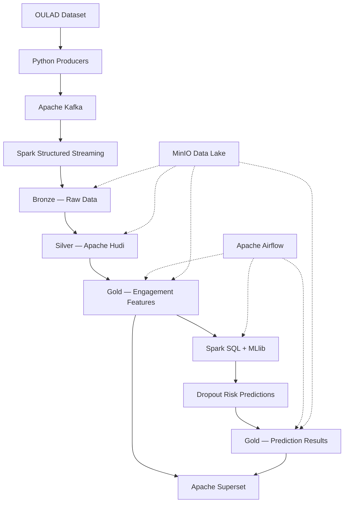

# 🎓 LearnSight

### Big Data Learning Analytics & Student Dropout Prediction

**From Learning Data to Student Success.**


---

## 📌 Overview

**LearnSight** is an end-to-end Big Data and Machine Learning platform designed to analyze student engagement in online learning environments and predict the risk of student dropout.

Using the **Open University Learning Analytics Dataset (OULAD)**, LearnSight aims to simulate real-time student activity, process large volumes of educational data, and transform them into actionable insights.

The platform combines data streaming, distributed processing, lakehouse storage, machine learning, workflow orchestration, and interactive analytics.

### 🎯 Objectives

- Ingest student learning events using Apache Kafka.
- Simulate real-time data streaming from historical OULAD records.
- Build a Bronze–Silver–Gold Data Lakehouse.
- Process educational data using Apache Spark.
- Predict student dropout risk with Spark MLlib.
- Automate processing pipelines using Apache Airflow.
- Visualize student engagement and risk indicators using Apache Superset.
- Deploy the platform reproducibly using Docker Compose.

> **Project status:** In development. The architecture and technology stack below describe the intended implementation, not an already deployed system.

---

## 🏗️ System Architecture



### Data Pipeline

| Layer | Technology | Responsibility |
|---|---|---|
| Data Source | OULAD | Historical student activity |
| Ingestion | Python, Kafka | Event replay and streaming |
| Processing | Spark Structured Streaming | Stream consumption |
| Bronze | MinIO | Raw data storage |
| Silver | Apache Hudi | Cleaned, validated data |
| Gold | Apache Hudi | Analytics features and predictions |
| Machine Learning | Spark MLlib | Dropout risk prediction |
| Orchestration | Airflow | Scheduled workflows |
| Visualization | Superset | Interactive dashboards |
| Infrastructure | Docker Compose | Containerized services |

---

## 📂 Dataset

### Open University Learning Analytics Dataset (OULAD)

LearnSight uses the publicly available OULAD dataset, which contains educational activity and assessment information from an online university.

**Dataset:** https://analyse.kmi.open.ac.uk/open_dataset

### Main Tables

| Table | Description |
|---|---|
| `studentInfo` | Student demographics and outcomes |
| `studentRegistration` | Registration and withdrawal information |
| `studentVle` | Student interactions and clicks |
| `studentAssessment` | Assessment submissions and scores |
| `assessments` | Assessment metadata |
| `courses` | Course and presentation information |
| `vle` | Virtual learning environment resources |

### Streaming Strategy

OULAD contains historical records. LearnSight will replay selected activity and assessment records as Kafka events to simulate a continuous learning platform.

**Kafka topics:**

- `clics_vle` — Student learning interactions
- `evaluations` — Assessment events

This is **simulated streaming**, not a live connection to a university system.

---

## 🛠️ Technology Stack

| Category | Technologies |
|---|---|
| Programming | Python, SQL |
| Streaming | Apache Kafka |
| Distributed Processing | Apache Spark, PySpark |
| Storage | MinIO |
| Lakehouse | Apache Hudi |
| Machine Learning | Spark MLlib |
| Orchestration | Apache Airflow |
| Visualization | Apache Superset |
| Optional SQL Serving | PostgreSQL |
| Infrastructure | Docker, Docker Compose |
| Version Control | Git, GitHub |

---

## 📁 Project Structure

```text
LearnSight/
│
├── ingestion/             # Kafka producers and event schemas
├── lakehouse/             # Bronze, Silver, Gold pipelines
├── spark/                 # Feature engineering and ML
├── airflow/               # DAGs and orchestration
├── dashboard/             # SQL queries and Superset assets
│
├── docker/                # Service Dockerfiles
├── config/                # Shared configurations
├── data/                  # Local datasets (mostly Git-ignored)
├── docs/                  # Technical documentation
├── tests/                 # Integration tests
├── scripts/               # Setup and utility scripts
├── .github/               # GitHub workflows and PR template
│
├── .env.example
├── .gitignore
├── docker-compose.yml     # Planned Docker integration
└── README.md
```

---

## 👥 Team Organization

LearnSight is organized into five technical workstreams.

| Member | Role | Main Responsibility |
|---|---|---|
| Student 1 | Data Ingestion Engineer | Kafka producers and streaming |
| Student 2 | Data Lakehouse Engineer | MinIO, Spark Streaming, Hudi |
| Student 3 | Spark & ML Engineer | Feature engineering and dropout prediction |
| Student 4 | Orchestration & Integration Engineer | Airflow and Docker integration |
| Student 5 | Dashboard Engineer | Superset dashboards and SQL |

### Shared Responsibilities

All team members contribute to:

- Integration testing
- Code reviews
- Documentation
- Docker configuration for their components
- Debugging and final demonstration

---

## 🚀 Getting Started

### Prerequisites

For the initial development stage:

- Git
- VS Code or another code editor
- Python 3.11 (target development version)

Docker Desktop and Docker Compose will be required once the containerized development environment is configured.

### 1. Clone the Repository

```bash
git clone https://github.com/YOUR_USERNAME/LearnSight.git
cd LearnSight
```

Replace `YOUR_USERNAME` with the repository owner's GitHub username.

### 2. Open in VS Code

```bash
code .
```

### 3. Check Your Git Branch

```bash
git branch
git status
```

### 4. Create Your Feature Branch

```bash
git switch -c feature/your-task
```

### 5. Configure the Environment

Once the infrastructure configuration is available:

```bash
cp .env.example .env
```

On Windows PowerShell:

```powershell
Copy-Item .env.example .env
```

Environment variables and service startup instructions will be documented in `docs/setup_guide.md`.

**Note:** Docker services are not yet guaranteed to be runnable. The Compose environment will be implemented and tested during the infrastructure setup phase.

---

## 🐳 Docker Development Strategy

LearnSight uses a **local development + shared integration** approach.

### Local Development

Each team member runs only the Docker services required for their component.

| Member | Required Services |
|---|---|
| Student 1 | Kafka |
| Student 2 | Kafka, Spark, MinIO |
| Student 3 | Spark, MinIO |
| Student 4 | Airflow, Spark |
| Student 5 | Superset, PostgreSQL if needed |

### Shared Integration

A designated shared environment will run the complete pipeline to validate interoperability.

The integration process will include:

1. Pulling reviewed code from `main`.
2. Building and starting the required services.
3. Running component and integration tests.
4. Verifying end-to-end data flow.
5. Checking logs and service health.

### Planned Docker Commands

Once `docker-compose.yml` is implemented:

```bash
docker compose up -d --build
docker compose ps
docker compose logs -f
docker compose down
```

Do not use these as setup instructions until the Compose configuration is complete.

---

## 🌿 Git Branching Strategy

The `main` branch contains reviewed and integrated code.

### Workstream Branches

```text
main
│
├── feature/kafka-ingestion
├── feature/data-lakehouse
├── feature/spark-ml
├── feature/airflow
└── feature/dashboard
```

As development progresses, prefer smaller task-specific branches and pull requests.

### Collaboration Workflow

**1. Update the local main branch**

```bash
git switch main
git pull origin main
```

**2. Create a task branch**

```bash
git switch -c feature/your-task
```

**3. Implement and test your changes**

**4. Commit your work**

```bash
git add .
git commit -m "feat: describe your changes"
```

**5. Push your branch**

```bash
git push -u origin feature/your-task
```

**6. Open a Pull Request**

Include:

- What changed
- Why it changed
- How it was tested
- Any dependencies or breaking changes

**7. Request review and merge**

At least one teammate should review the changes before merging into `main`.

### Commit Convention

| Prefix | Usage |
|---|---|
| `feat:` | New feature |
| `fix:` | Bug fix |
| `docs:` | Documentation |
| `refactor:` | Code restructuring |
| `test:` | Tests |
| `chore:` | Configuration or maintenance |

Example:

```bash
git commit -m "feat: add Kafka VLE event producer"
```

---

## 🧠 Machine Learning

LearnSight plans to compare two Spark MLlib models:

- Logistic Regression
- Random Forest

### Potential Features

- Weekly click count
- Number of active days
- Assessment performance
- Engagement trend
- Missed assessments

### Evaluation

The models will be evaluated using:

- Precision
- Recall
- F1-score
- Confusion matrix
- PR-AUC where appropriate

Temporal evaluation will be used where feasible to reduce data leakage. Features must only include information available at prediction time.

Predictions are intended as decision-support signals, not definitive judgments about individual students.

---

## 📊 Planned Dashboards

### 1. Learning Overview

- Total students
- Weekly activity
- Engagement by course
- Click trends

### 2. Dropout Risk Monitoring

- At-risk student count
- Risk score distribution
- Students with elevated risk
- Course and period filters

### 3. ML Performance

- Model comparison
- Precision, Recall, F1-score
- Confusion matrix
- Feature importance where supported

---

## 🗓️ Development Roadmap

| Phase | Focus | Status |
|---|---|---|
| Week 1 | GitHub setup, architecture, dataset exploration | Planned |
| Week 2 | Kafka ingestion and Bronze | Planned |
| Week 3 | Spark and Hudi Silver/Gold | Planned |
| Week 4 | Feature engineering and ML | Planned |
| Week 5 | Airflow and Superset | Planned |
| Week 6 | Integration, testing, documentation | Planned |

This is the team's proposed six-week plan and may be adjusted to match the academic schedule.

---

## 🧪 Testing Strategy

Testing will be performed at two levels.

### Component Tests

Each student tests their own module.

### Integration Tests

The complete pipeline will be validated:

```text
OULAD
  ↓
Kafka
  ↓
Spark Streaming
  ↓
MinIO / Hudi
  ↓
Spark SQL + MLlib
  ↓
Gold Predictions
  ↓
Superset
```

Airflow will orchestrate the scheduled processing stages.

---

## 📦 Expected Deliverables

- Project specification document
- Complete GitHub repository
- Docker Compose configuration
- Kafka ingestion pipeline
- Hudi Data Lakehouse
- Spark processing and ML models
- Airflow DAGs
- Superset dashboard
- Integration tests
- Final technical report
- Presentation and live demonstration

---

## 🔐 Security & Data Management

- Never commit credentials or API keys.
- Keep `.env` files out of Git.
- Use `.env.example` for configuration templates.
- Avoid committing large raw datasets.
- Use local or managed persistent storage for data.
- Do not expose services publicly without authentication.
- Use appropriate safeguards when displaying student-level information.

---

## 📚 References

- [OULAD Dataset](https://analyse.kmi.open.ac.uk/open_dataset)
- [Apache Kafka](https://kafka.apache.org/)
- [Apache Spark](https://spark.apache.org/)
- [Apache Hudi](https://hudi.apache.org/)
- [Apache Airflow](https://airflow.apache.org/)
- [Apache Superset](https://superset.apache.org/)
- [MinIO](https://min.io/)
- [Docker](https://docs.docker.com/)

---

## 📄 License

A license has not yet been selected. The project team will determine the appropriate license before public release.

---

**LearnSight — From Learning Data to Student Success.**

*Built collaboratively by a team of five Data & AI Engineering students.*
